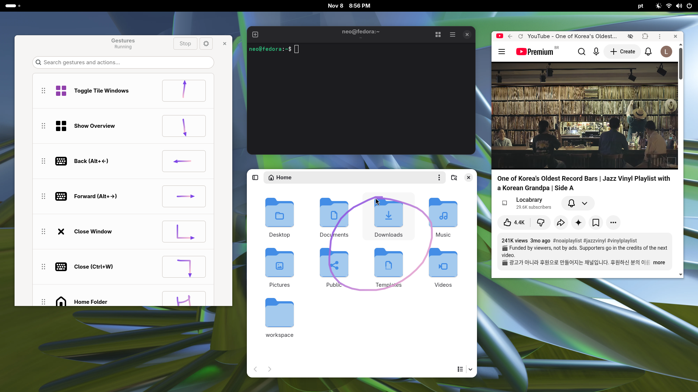
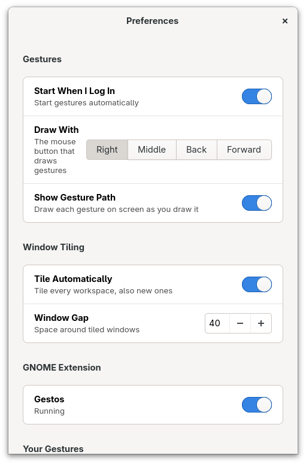
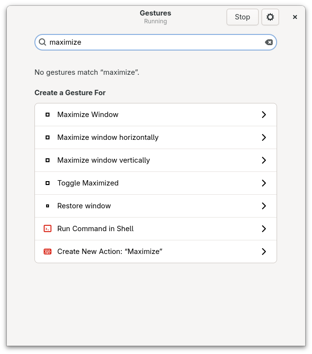
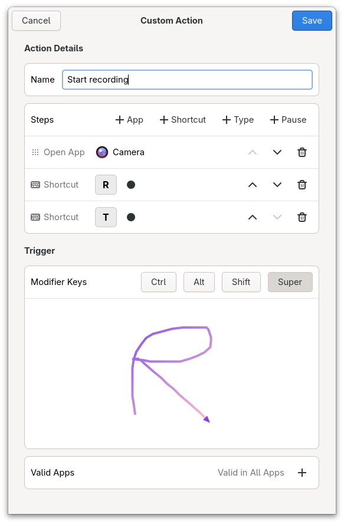
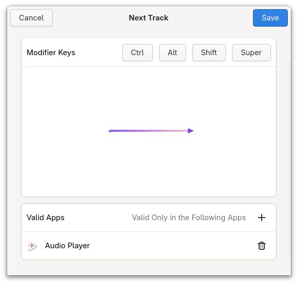

# Gestos

Mouse gestures for Linux.



## Features

- Gestures per app: each app can have its own actions, on GNOME, KDE and X11 desktops
- Modifier keys: the same gesture does more with Ctrl, Alt, Shift or Super held
- Your choice of trigger button: right, middle, back or forward
- Built for Wayland
- Works on GNOME, KDE, Sway, Hyprland and XFCE



## Actions Supported

- The actions GNOME and KDE expose, like moving windows, switching workspaces and controlling media
- Open any installed app, or bring it to the front
- Press any keyboard shortcut
- Type text, including several lines and accented letters
- Run shell commands
- Custom actions: open apps, press shortcuts, type text and pause, in any order





## GNOME Gestos Extension

- The gesture's path drawn on screen as you draw it
- Advanced window tiling that keeps windows from overlapping



## Install

Packages for Fedora, Debian and Alpine are on the [releases page](https://github.com/deters/gestos/releases).

On GNOME, log out and back in after installing, then turn on the Gestos extension in Preferences.

### From source

Install the dependencies:

```bash
# Fedora
sudo dnf install gtk4-devel libadwaita-devel meson ninja-build cargo gcc git

# Debian 13
sudo apt install libgtk-4-dev libadwaita-1-dev meson ninja-build cargo build-essential pkg-config git

# Alpine
apk add gtk4.0-dev libadwaita-dev meson cargo gcc musl-dev git
```

Older systems may need a newer Rust from [rustup](https://rustup.rs). Rust 1.75, from Ubuntu 24.04, is too old, and 1.85 works.

Then build and install:

```bash
git clone https://github.com/deters/gestos.git
cd gestos
meson setup build --buildtype=release
meson compile -C build
sudo meson install -C build
```

Building with `-Dgnome_extension=false` leaves out the GNOME extension.

If you're updating an older install, run the install step again. It removes the Set-Group-ID permission that `gestosd` used to have, and starts the input service.

## Troubleshooting

Attach a report to [bug reports](https://github.com/deters/gestos/issues): Preferences → Troubleshooting → Create Report, or `gestos --debug-info`.

## Security

Mouse gestures need access to your input devices, so Gestos keeps that access in a small, sandboxed system service, apart from everything else. The rest of the app runs as you, with no special rights.

The service never passes on what you type, and only works for the user at the screen. Gestures are ignored while the screen is locked, on desktops that report it.

Programs you run can still ask the service to press keys, so it protects you from other users and from keylogging, not from software you already run.

## Development

`make` builds an unoptimized version in `build/`, and `sudo make install` installs it.

```bash
make
dbus-run-session -- cargo test
```

The tests use a private D-Bus session, and some are skipped without one.

### Faster rebuilds

`clang` and `mold` link much faster, and lighter debug info makes the binaries smaller. Nothing needs them to build or run the project. Install them with your package manager, then add this to `~/.cargo/config.toml`:

```toml
[target.x86_64-unknown-linux-gnu]
linker = "clang"
rustflags = ["-C", "link-arg=-fuse-ld=mold"]

[profile.dev]
debug = "line-tables-only"
```

Change `x86_64-unknown-linux-gnu` to match your system if it differs (`rustc -vV` shows it as `host`). The next build recompiles everything once. This applies to all your Rust projects, and you lose local variables in a debugger, though panics keep their file and line numbers.

## History

Gestos was formerly known as MyGestures.

## License

GPL-2.0-or-later. See [COPYING](COPYING).
