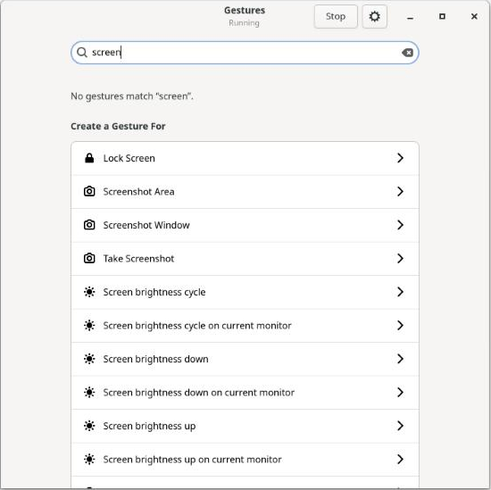
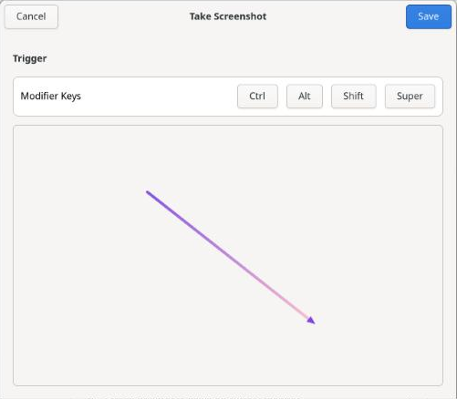
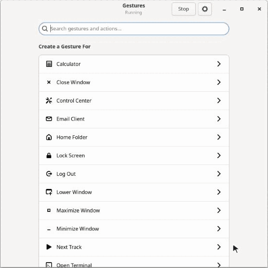
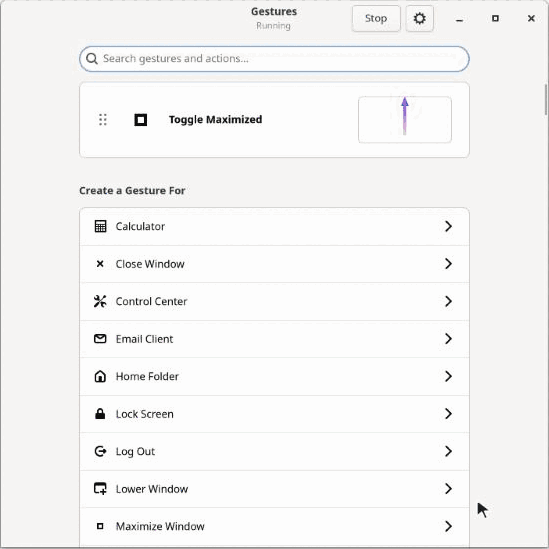

# Gestos

Formerly known as MyGestures. Your MyGestures config and autostart entry are carried over the first time Gestos runs.

## Get started

Search some action and create a gesture:



Draw the gesture and save it:



That's it. Hold the right mouse button anywhere, draw your gesture, and let go. A short click still works as a normal right click.

Here it is from the start, with an upward gesture that maximizes a window:



And an S-shaped one that saves:



## Install

Packages for Fedora, Debian, and Alpine are on the [releases page](https://github.com/deters/gestos/releases).

### From source

Install the dependencies:

```bash
# Fedora
sudo dnf install gtk4-devel meson ninja-build cargo gcc git

# Debian 13
sudo apt install libgtk-4-dev meson ninja-build cargo build-essential pkg-config git

# Alpine
apk add gtk4.0-dev meson cargo gcc musl-dev git
```

Older systems may need a newer Rust from [rustup](https://rustup.rs). Rust 1.75, from Ubuntu 24.04, is too old, and 1.85 works.

Then build and install:

```bash
git clone https://github.com/deters/gestos.git
cd gestos
meson setup build --buildtype=release
meson compile -C build
sudo meson install -C build
```

If you're updating an older install, run the install step again. It removes the Set-Group-ID permission that `gestosd` used to have, and starts the input service.

### Tiling on GNOME

Toggle Tile Windows needs the “Gestos” GNOME extension, which comes with Gestos. After installing, log out and back in, then turn it on in Gestos's Preferences. Other desktops don't use it, and building with `-Dgnome_extension=false` leaves it out.

## Security

Mouse gestures need access to your input devices, so Gestos keeps that access in a small, sandboxed system service, apart from everything else. The rest of the app runs as you, with no special rights.

The service never passes on what you type, and only works for the user at the screen. Gestures are ignored while the screen is locked, on desktops that report it.

Programs you run can still ask the service to press keys, so it protects you from other users and from keylogging, not from software you already run.

## Development

`make` builds an unoptimized version in `build/`, and `sudo make install` installs it.

```bash
make
dbus-run-session -- cargo test
```

The tests use a private D-Bus session, and some are skipped without one.

### Faster rebuilds

`clang` and `mold` link much faster, and lighter debug info makes the binaries smaller. Nothing needs them to build or run the project. Install them with your package manager, then add this to `~/.cargo/config.toml`:

```toml
[target.x86_64-unknown-linux-gnu]
linker = "clang"
rustflags = ["-C", "link-arg=-fuse-ld=mold"]

[profile.dev]
debug = "line-tables-only"
```

Change `x86_64-unknown-linux-gnu` to match your system if it differs (`rustc -vV` shows it as `host`). The next build recompiles everything once. This applies to all your Rust projects, and you lose local variables in a debugger, though panics keep their file and line numbers.

## License

GPL-2.0-or-later. See [COPYING](COPYING).
