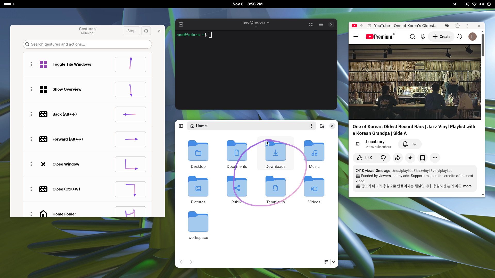
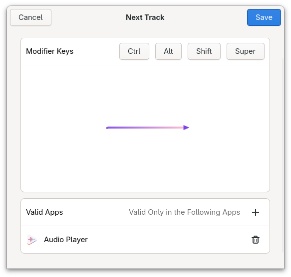
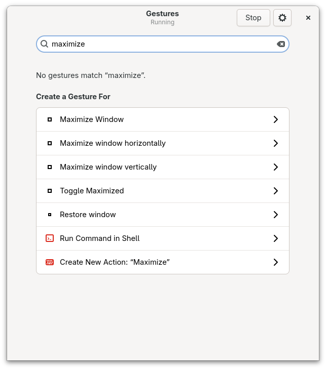
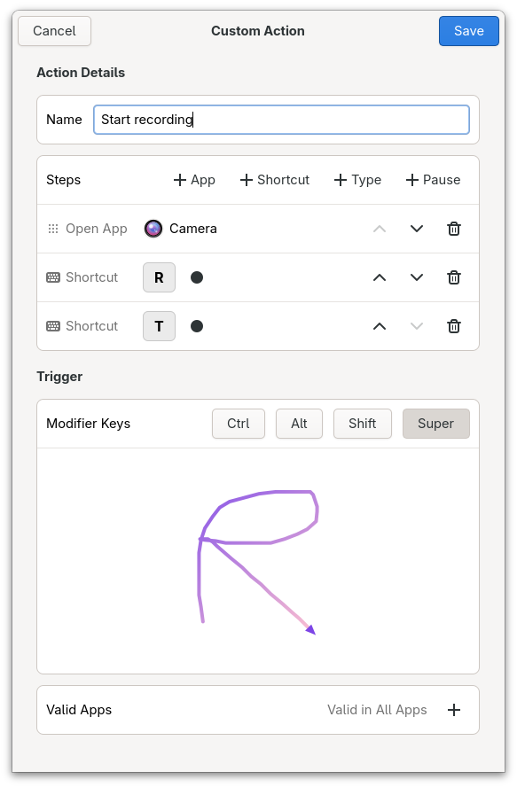
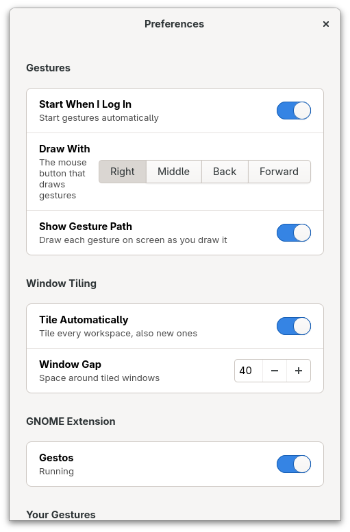

# Gestos

Mouse gestures for Linux.



## Features

- Different gestures for each app, on GNOME, KDE and X11 desktops
- Ctrl, Alt, Shift and Super turn one gesture into several
- Draw with the right, middle, back or forward button
- Wayland and X11
- GNOME, KDE, Sway, Hyprland and XFCE



## Actions Supported

- The actions GNOME and KDE expose, such as moving windows, switching workspaces and media controls
- Opening an app, or switching to it if it's already open
- Keyboard shortcuts
- Typing text, line breaks and accents included
- Shell commands
- Custom actions that chain apps, shortcuts, text and pauses





## GNOME Gestos Extension

- The path shows on screen while you draw
- Advanced window tiling that keeps windows from overlapping



## Install

```bash
curl -fsSL https://github.com/deters/gestos/releases/latest/download/install.sh | sh
```

This installs the package for your system, or updates it, after checking it against the release's checksums. Add `-s -- --beta` after `sh` to install the beta, when there's one newer than the release. On a system Gestos wasn't tested on, like openSUSE, it asks before installing.

Or download the package for your system from the [releases page](https://github.com/deters/gestos/releases), then install it:

| System | Package | Install with |
|---|---|---|
| Ubuntu, Debian | `gestos_<version>_amd64.deb` | `sudo apt install ./gestos_*_amd64.deb` |
| Fedora | `gestos-<version>.x86_64.rpm` | `sudo dnf install ./gestos-*.x86_64.rpm` |
| Fedora on ARM | `gestos-<version>.aarch64.rpm` | `sudo dnf install ./gestos-*.aarch64.rpm` |
| Alpine | `gestos-<version>-x86_64.apk` | `doas apk add --allow-untrusted ./gestos-*-x86_64.apk` |
| Alpine on ARM | `gestos-<version>-aarch64.apk` | `doas apk add --allow-untrusted ./gestos-*-aarch64.apk` |

On GNOME, log out and back in after installing, then turn on the Gestos extension in Preferences.

### From source

Install the dependencies:

```bash
# Fedora
sudo dnf install gtk4-devel libadwaita-devel meson ninja-build cargo gcc git

# Debian 13
sudo apt install libgtk-4-dev libadwaita-1-dev meson ninja-build cargo build-essential pkg-config git

# Alpine
apk add gtk4.0-dev libadwaita-dev meson cargo gcc musl-dev git
```

Ubuntu 24.04's Rust 1.75 is too old. Get 1.85 or newer from [rustup](https://rustup.rs).

Then build and install:

```bash
git clone https://github.com/deters/gestos.git
cd gestos
meson setup build --buildtype=release
meson compile -C build
sudo meson install -C build
```

To build without the GNOME extension, add `-Dgnome_extension=false` to `meson setup`.

Updating an older install? Run the install step again. It drops the Set-Group-ID bit `gestosd` used to have and starts the input service.

## Troubleshooting

When you [report a bug](https://github.com/deters/gestos/issues), attach the report from Preferences → Troubleshooting → Create Report, or the output of `gestos --debug-info`.

## Security

Mouse gestures need access to input devices, and that access normally lets a program read every key you type. Many gesture tools get it by adding you to the `input` group, which gives that access to every program you run. We didn't want that, so Gestos keeps it in one small system service, `gestos-input`, which runs as a user of its own, with no network, no access to your home folder and no files it can write. It passes your mouse on, sends only the path you draw, and never reads what you type: right after a gesture, it only checks which of Ctrl, Alt, Shift and Super are held.

Everything else runs as you, with no extra rights: `gestosd`, the background process that recognizes gestures and runs their actions, and `gestos`, the graphical interface, open only while it's on the screen. `gestos-input` only answers the user at the screen, and `gestosd` ignores gestures while the screen is locked, on desktops that report it.

On GNOME, apps can't draw over the screen, move other apps' windows, or see which app is in use or what you've selected in it, and GNOME offers no other way to ask. We wanted gestures that show their path, tile windows and act on the app in use, so we made the Gestos extension, which does these from inside GNOME Shell.

Programs you run yourself can still ask `gestos-input` to press keys, even in other apps' windows, as tools that type for you can. They could also ask the Gestos extension for what you've selected or copied. If that matters to you, turn the extension off in Extensions. Gestures still work without it, but without the path, tiling, gestures for one app, and the actions that use what you've selected or copied. On systems without systemd, like Alpine, `gestos-input` runs as its own user without the other limits.

## Development

`make` builds an unoptimized version in `build/`, and `sudo make install` installs it.

```bash
make
dbus-run-session -- cargo test
```

The tests use a private D-Bus session, and some are skipped without one.

### Faster rebuilds

Optional: `clang` and `mold` link much faster, and lighter debug info makes smaller binaries. Install both, then add this to `~/.cargo/config.toml`:

```toml
[target.x86_64-unknown-linux-gnu]
linker = "clang"
rustflags = ["-C", "link-arg=-fuse-ld=mold"]

[profile.dev]
debug = "line-tables-only"
```

Use your own target if it isn't `x86_64-unknown-linux-gnu` (`rustc -vV` prints it as `host`). The next build starts from scratch. The settings apply to all your Rust projects, and debuggers no longer see local variables, but panics still show file and line.

## History

Gestos used to be called MyGestures.

## License

GPL-2.0-or-later. See [COPYING](COPYING).
