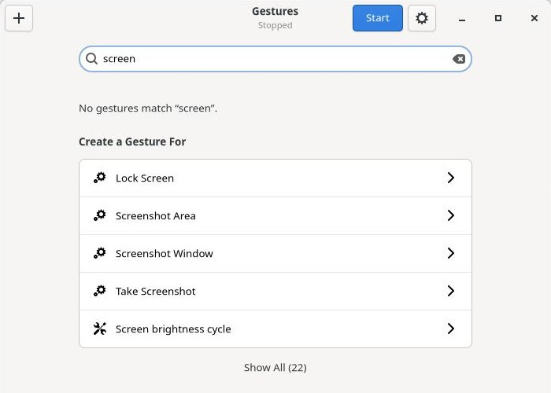
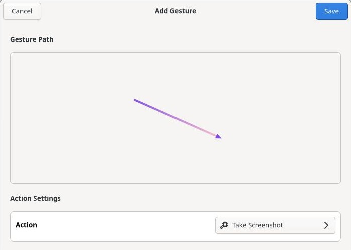

# Gestos

## Get started

Search some action and create a gesture:



Draw the gesture and save it. Gestos warns you if your drawing is close to one you already have:



That's it. Hold the right mouse button anywhere, draw your gesture, and let go. A short click still works as a normal right click.

## Install

Packages for Fedora, Debian, and Alpine are on the [releases page](https://github.com/deters/gestos/releases).

### From source

Install the dependencies:

```bash
# Fedora
sudo dnf install pkgconf-pkg-config gtk4-devel libevdev-devel git meson ninja-build cargo

# Ubuntu / Debian
sudo apt install pkg-config libgtk-4-dev libevdev-dev git meson ninja-build cargo

# Alpine
apk add git meson cargo sudo make glib-dev cairo-dev gdk4 gdk-pixbuf-dev pango-dev gtk4.0-dev
```

Then build and install:

```bash
git clone https://github.com/deters/gestos.git
cd gestos
meson setup build --buildtype=release
meson compile -C build
sudo meson install -C build
```

## Development

`make` builds an unoptimized version in `build/`, and `sudo make install` installs it.

```bash
make
dbus-run-session -- cargo test
```

The tests use a private D-Bus session, and some are skipped without one.

### Faster rebuilds

`clang` and `mold` link much faster, and lighter debug info makes the binaries smaller. Nothing needs them to build or run the project. Install them with your package manager, then add this to `~/.cargo/config.toml`:

```toml
[target.x86_64-unknown-linux-gnu]
linker = "clang"
rustflags = ["-C", "link-arg=-fuse-ld=mold"]

[profile.dev]
debug = "line-tables-only"
```

Change `x86_64-unknown-linux-gnu` to match your system if it differs (`rustc -vV` shows it as `host`). The next build recompiles everything once. This applies to all your Rust projects, and you lose local variables in a debugger, though panics keep their file and line numbers.

## License

GPL-2.0-or-later. See [COPYING](COPYING).
